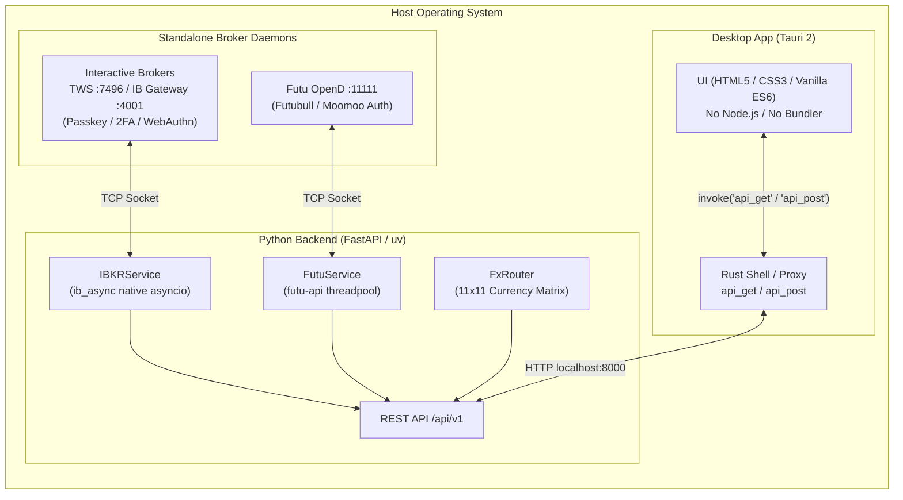

# uninv: Unified Investing Platform (v1.0.0)

**uninv** (**uni**fied + **inv**esting) is a cross-platform desktop application designed for retail investors to monitor and consolidate multiple broker accounts into a **single, unified portfolio view**. 

It pulls real-time balances, margins, multi-currency cash holdings, and open positions directly from local broker gateway daemons, translates them into standardized financial models, and provides instantaneous multi-currency conversion across 11 global fiat currencies.

---

## Key Features

- **Multi-Broker & Meta-Broker Aggregation:**
  - **Interactive Brokers (IBKR):** Connects to TWS or IB Gateway via `ib_async` on port 7496/4001, pulling live account margins, cash balances, and positions across equities, options, and futures options with OCC instrument parsing.
  - **Futu / Moomoo Meta-Broker:** Connects to Futu OpenD on port 11111 via `futu-api`. Ingests accounts at the **Universal Account** level (`uni_card_num`), consolidating sub-accounts across all trade contexts (Securities, Futures, Crypto) and corporate entities (Futubull HK, Moomoo US, Futu SG, etc.).
- **Unidirectional Reactive Portfolio UI:**
  - **Accounts Selector:** Horizontal account tiles. Selecting "All Accounts" presents consolidated figures; selecting an individual account tile filters metrics and holdings to that specific account.
  - **Account Values Board:** Clear 6-item financial ledger:
    - **Row 1:** Net Liquidation Value, Gross Position Value, Cash Balance (`Cash Balance + Gross Position Value == Net Liquidation Value`).
    - **Row 2:** Unrealised P&L (with % return badge), Maintenance Margin, Excess Liquidity.
  - **Holdings — 12-Column Positions Table:** Columns from left to right:
    `Broker / Account` (stacked), `Instrument / Symbol` (stacked), `Type / Exchange` (stacked), `Position`, `Avg Price`, `Mark Price`, `Cost Basis`, `Market Value`, `Last Trading Date`, `Unrealised P&L`, `Weight` (portfolio weight % calculated per active tile scope), `Currency`.
    In "All Accounts" mode, positions are displayed additively without forced symbol merging.
  - **Multi-Currency Cash Balances:** Displays raw amounts in original currencies alongside converted values.
- **Global FX Matrix & Instant Client-Side Conversion:**
  - Synthesizes a full 11×11 conversion matrix (`USD`, `HKD`, `EUR`, `GBP`, `JPY`, `CAD`, `AUD`, `CHF`, `CNH`, `SGD`, `NZD`) via IDEALPRO quote probes and graph routing.
  - Changing the headbar currency dropdown recalculates the entire dashboard locally with **zero network latency**.
- **Dynamic Broker Gateway Configuration & Testing:**
  - Settings page allows configuring Host/IP (default `127.0.0.1`) and Port for each broker gateway with `Edit` and `Save` controls.
  - Live connection testing via `GET /api/v1/broker-connection-test` with instant status badges (`✓ Connected` / `✗ Offline`).
- **Precision Data Integrity:**
  - Zero rounding in the backend; full float precision preserved for fractional shares and crypto holdings.
  - Display rounding (2 decimal places) applied only to monetary values on the frontend.
  - Accurate `asof` timestamps captured strictly after all network fetches complete, with hover tooltips detailing individual endpoint latencies.

---

## Architecture



### Why Standalone Broker Daemons?
`uninv` does **not** store or ask for your broker account passwords or API secrets. Instead, you run your broker's official standalone gateway (TWS, IB Gateway, or Futu OpenD) on your machine. Those programs handle biometric passkeys (Windows Hello, Touch ID), hardware FIDO2 keys, and SMS/app 2FA natively. Once authenticated, `uninv` communicates locally over private loopback sockets (`127.0.0.1`).

---

## Repository Layout

```text
uninv/
├── backend/                       # Python 3.13 FastAPI service (uv project)
│   ├── pyproject.toml             # Dependencies and tool configurations
│   ├── uv.lock                    # Locked dependency versions
│   ├── src/uninv_backend/
│   │   ├── __init__.py            # CLI entry point (`uv run uninv-backend`)
│   │   ├── app.py                 # FastAPI application factory & CORS setup
│   │   ├── config.py              # Pydantic BaseSettings & dynamic gateway updates
│   │   ├── models.py              # Unified Pydantic models & strict StrEnums
│   │   ├── ibkr.py                # Native asyncio IBKR connector (ib_async)
│   │   ├── futu.py                # Threadpool Futu meta-broker connector (futu-api)
│   │   ├── fx.py                  # FX matrix router & cross-rate pathfinding
│   │   └── api/routes.py          # Clean REST endpoints under /api/v1
│   └── tests/                     # Comprehensive test suite (31 tests)
├── desktop/                       # Tauri 2 cross-platform desktop shell
│   ├── src/                       # Frontend web assets (served without Node.js)
│   │   ├── index.html             # Application markup (Portfolio, Settings, About)
│   │   ├── styles.css             # Dark theme design system & hairline layouts
│   │   ├── assets/                # App brand icons (SVG, PNG)
│   │   └── js/
│   │       ├── api.js             # Tauri invoke proxy with browser fetch fallback
│   │       ├── format.js          # Currency, percentage, quantity formatters & FX
│   │       └── main.js            # Reactive application controller & event wiring
│   └── src-tauri/                 # Thin Rust shell
│       ├── Cargo.toml             # Rust dependencies (reqwest, serde, tauri)
│       ├── tauri.conf.json        # Tauri 2 configuration & capabilities
│       └── src/lib.rs             # Generic api_get / api_post commands
├── docs/                          # Architectural decisions & post-mortem records
├── gateways/                      # Setup instructions for IB Gateway & Futu OpenD
├── scripts/                       # Cross-platform startup scripts (Windows, macOS, Linux)
└── AGENTS.md                      # AI coding agent operational guidance & project status
```

---

## Prerequisites

| Tool | Purpose | Installation |
|---|---|---|
| [uv](https://docs.astral.sh/uv/) | Fast Python package management | `powershell -ExecutionPolicy ByPass -c "irm https://astral.sh/uv/install.ps1 \| iex"` |
| [Rust](https://rustup.rs/) | Compiles the Tauri desktop shell | `winget install Rustlang.Rustup` |
| MSVC C++ Build Tools | Linker for Rust on Windows | `winget install Microsoft.VisualStudio.2022.BuildTools --override "--passive --wait --add Microsoft.VisualStudio.Workload.VCTools --includeRecommended"` |
| WebView2 | System webview renderer | Pre-installed on Windows 10/11 |
| Broker Gateways | Live account feeds | [IB Gateway / TWS](gateways/ib_gateway/instruction.md) & [Futu OpenD](gateways/futu_gateway/instruction.md) |

---

## Quick Start (For Developers)

### 1. Clone the Repository
```powershell
git clone https://github.com/DHKLeung/uninv.git
cd uninv
```

### 2. Install Backend Dependencies (First-Time Only)
```powershell
cd backend
uv sync
cd ..
```

### 3. Launch Everything (One-Click Entry Point)
To launch the complete application (Python FastAPI backend + Tauri native desktop shell):

- **Windows (PowerShell):**
  ```powershell
  .\scripts\start-all.ps1
  ```
  *(Or double-click `scripts\start-all.cmd`)*

- **macOS / Linux (Bash):**
  ```bash
  ./scripts/start-all.sh
  ```

#### How It Works & Automatic Compilation:
- **Backend Orchestration:** The script starts the Python FastAPI server in the background and continuously probes `http://127.0.0.1:8000/health` until the service reports healthy.
- **Automatic Rust Compilation:** Once the backend is healthy, the script automatically changes into `desktop/src-tauri` and executes `cargo tauri dev` (or `cargo run`). **On first execution, Cargo automatically resolves all Rust crates and compiles the Tauri native desktop shell without requiring separate build commands.** Subsequent launches use the cached build and open immediately.
- **Graceful Process Teardown:** Pressing `Ctrl+C` in your terminal automatically terminates the desktop app and background Python backend together cleanly.

### 4. Browser Development Mode (Zero Rust Compilation Required)
If you are developing features in Python or editing HTML/CSS/JS in the UI and do not wish to compile Rust:
```powershell
.\scripts\start-all.ps1 -Browser
```
This starts the FastAPI backend and automatically opens the UI in your default web browser at `http://127.0.0.1:1420`.

### 5. Running Components Independently
```powershell
# Run backend only (FastAPI on :8000, docs at http://127.0.0.1:8000/docs)
.\scripts\start-backend.ps1

# Run desktop app only (requires backend running)
.\scripts\start-desktop.ps1
```

---

## REST API Reference

While the backend is running, interactive OpenAPI documentation is available at <http://127.0.0.1:8000/docs>.

| Method | Endpoint | Description |
|---|---|---|
| `GET` | `/health` | Service liveness probe returning version `1.0.0`. |
| `GET` | `/api/v1/supporting-brokers` | Returns configured brokers: `[{"id": "ibkr", "name": "Interactive Brokers"}, {"id": "futu", "name": "Futu"}]`. |
| `GET` | `/api/v1/accounts?broker_id={id}` | Returns active account IDs with UTC `asof` timestamp. |
| `GET` | `/api/v1/snapshot?broker_id={id}&account_id={id}` | Returns complete live snapshot: `AccountValues`, open `Position` list, and completion `asof`. |
| `GET` | `/api/v1/fx` | Returns full 11×11 FX rates conversion matrix across all supported currencies. |
| `GET` | `/api/v1/broker-connection-test?broker_id={id}` | Probes gateway TCP port and verifies handshake connectivity. |
| `GET` | `/api/v1/broker-gateway-config` | Returns current configured Host/IP and Port for each broker gateway. |
| `POST` | `/api/v1/broker-gateway-config` | Updates Host/IP and Port configuration for a broker gateway. |

---

## Development & Testing

```powershell
# Run backend test suite (31 tests)
cd backend
uv run pytest

# Format and lint Python codebase
uv run ruff format .
uv run ruff check --fix .

# Verify Tauri Rust shell compilation
cd ../desktop/src-tauri
cargo check
```

---

## Roadmap

- [x] **v1.0.0: Unified Retail Portfolio Core**
  - [x] Standalone broker daemon architecture (IB Gateway/TWS on port 7496, Futu OpenD on port 11111).
  - [x] Futu meta-broker multi-context ingestion (Securities, Futures, Crypto across all global entities).
  - [x] Streamlined Account Values ledger (`Cash Balance + Gross Position Value == Net Liquidation Value`).
  - [x] Holdings Positions table (12 columns: broker, instrument/symbol, type/exchange, position, avg price, mark price, cost basis, market value, last trading date, unrealised P&L, weight, currency).
  - [x] Dynamic FX matrix synthesis & instant client-side conversion across 11 global currencies.
  - [x] Settings page for runtime broker gateway Host/IP and Port configuration with connection testing.
  - [x] Production packaging readiness with consistent purple square branding.
- [ ] **v1.1.0: Local Persistence & Analytics**
  - [ ] Local SQLite storage for historical portfolio snapshots and equity curve tracking.
  - [ ] User-configurable asset allocation targets and DCA rebalancing planners.
  - [ ] Consolidated portfolio performance and allocation charts.
- [ ] **v2.0.0: Option Strategy Tools & Native Packaging**
  - [ ] PyInstaller sidecar embedding for single-click zero-install desktop distribution.
  - [ ] Interactive multi-leg option strategy payoffs and Greeks visualization.
