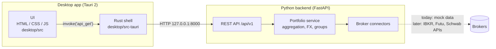

# uninv: Unified Investing Platform

uninv is a desktop app that puts all your broker accounts into **one portfolio view**. Accounts,
positions, allocation and P&L from every broker show up together, converted into one base
currency, and you can organise positions into your own **groups** that span brokers.

> **Status: early development.** No real brokers are connected yet. The backend returns
> **simulated** positions for Interactive Brokers, Futu and Charles Schwab, so the UI and
> aggregation can be built first. The app shows a "Simulated data" badge while that's the case.

Planned later: an option strategy builder, live prices, editable groups, and more (see the
[Roadmap](#roadmap)).

## Architecture



| Layer | Tech | Role | You edit it when... |
|---|---|---|---|
| `backend/` | Python 3.13, FastAPI, uv | Broker connections, aggregation, all business logic | you add brokers, data or endpoints (**most work happens here**) |
| `desktop/src/` | Plain HTML/CSS/JS | What you see | you change the UI |
| `desktop/src-tauri/` | Rust, Tauri 2 | Native window + a generic proxy to the backend | rarely: window settings, packaging |

The Rust layer is deliberately thin. It exposes one generic command, `api_get(path)`, which
forwards to any backend `/api/...` endpoint. **A new FastAPI endpoint can be called from the UI
without touching Rust.** More detail in [docs/architecture.md](docs/architecture.md).

## Repository layout

```text
uninv/
├── backend/                    # Python FastAPI service (uv project)
│   ├── pyproject.toml          # dependencies + tool config
│   ├── uv.lock                 # locked dependency versions (commit this)
│   ├── src/uninv_backend/
│   │   ├── app.py              # FastAPI app
│   │   ├── models.py           # shared data models (the contract)
│   │   ├── api/routes.py       # /api/v1 endpoints
│   │   ├── brokers/            # one connector per broker (+ mock.py)
│   │   └── portfolio/          # aggregation service + groups
│   └── tests/
├── desktop/                    # Tauri 2 desktop app
│   ├── src/                    # frontend: index.html, styles.css, js/
│   ├── src-tauri/              # Rust: Cargo.toml, tauri.conf.json, src/lib.rs
│   └── app-icon.png            # source image for app icons
├── docs/                       # design notes
├── scripts/dev.ps1             # run everything in dev mode
└── AGENTS.md                   # instructions + project status for AI coding agents
                                # (nested ones in backend/ and desktop/)
```

## Prerequisites (Windows)

| Tool | Why | Install |
|---|---|---|
| [uv](https://docs.astral.sh/uv/) | Python + dependency management | `powershell -ExecutionPolicy ByPass -c "irm https://astral.sh/uv/install.ps1 \| iex"` |
| [Rust](https://rustup.rs/) | Builds the desktop app | `winget install Rustlang.Rustup` |
| MSVC C++ Build Tools | Rust's linker on Windows | `winget install Microsoft.VisualStudio.2022.BuildTools --override "--passive --wait --add Microsoft.VisualStudio.Workload.VCTools --includeRecommended"` |
| WebView2 | Renders the UI | Already included in Windows 10/11 |
| Tauri CLI *(optional)* | `cargo tauri dev/build/icon` | `cargo install tauri-cli --version "^2" --locked` |

uv downloads the right Python version for you, so you don't need a separate Python install.

## Quick start

```powershell
# 1. Install backend dependencies (first time only)
cd backend
uv sync
cd ..

# 2. Run backend + desktop app together (Ctrl+C stops both)
.\scripts\dev.ps1       # or .\scripts\dev.cmd if PowerShell execution policy blocks .ps1
```

The first desktop build compiles the Rust dependencies and takes a few minutes. Later builds
are quick.

**Only working on the backend or UI?** Use `.\scripts\dev.ps1 -Browser` instead. It starts the
backend and opens the UI in your web browser at <http://127.0.0.1:1420>, with no Rust build
needed. Refresh the page after editing files in `desktop/src`.

### Running pieces manually

```powershell
# Backend (from backend/)
uv run uninv-backend --reload          # API on http://127.0.0.1:8000, docs at /docs
uv run pytest                          # tests
uv run ruff check . ; uv run ruff format .

# Desktop (from desktop/src-tauri/, with the backend running)
cargo tauri dev                        # or: cargo run
cargo tauri build                      # produce an installer in target/release/bundle
```

Settings use environment variables: `UNINV_PORT`, `UNINV_BASE_CURRENCY` (backend; see
`config.py`) and `UNINV_BACKEND_URL` (desktop app).

## API

Interactive docs: <http://127.0.0.1:8000/docs> (while the backend is running).

| Method | Path | Returns |
|---|---|---|
| GET | `/health` | Liveness check |
| GET | `/api/v1/portfolio` | **Everything for the dashboard:** totals, accounts, allocations (asset class / currency / symbol / group), positions, broker errors |
| GET | `/api/v1/brokers` | Connected brokers |
| GET | `/api/v1/accounts` | Accounts across all brokers |
| GET | `/api/v1/groups` | User-defined position groups |
| GET | `/api/v1/positions?account_id=&group_id=` | Positions in base currency, optionally filtered |

## Common tasks

**Connect a real broker.** Add `backend/src/uninv_backend/brokers/<broker>.py` implementing
`BrokerConnector` (`get_accounts`, `get_positions`), then swap it in for the mock in
`brokers/registry.py`. See [backend/README.md](backend/README.md).

**Add an endpoint and show it in the UI.**
1. Add a route in `backend/src/uninv_backend/api/routes.py`.
2. Call it from JS with `apiGet("/api/v1/your-endpoint")` (see `desktop/src/js/api.js`). No Rust
   changes are needed.

**Change position groups.** For now, edit `backend/src/uninv_backend/portfolio/groups.py`.

**Regenerate app icons.** Replace `desktop/app-icon.png` (1024×1024), then from
`desktop/src-tauri` run `cargo tauri icon ../app-icon.png`.

## Roadmap

- [x] Project scaffold: FastAPI backend (uv) + Tauri 2 desktop app
- [x] Unified portfolio from simulated brokers: multi-account, multi-currency, groups, options
- [ ] Real broker connectors (e.g. IBKR, Futu, Schwab), with credentials kept in the OS keychain
- [ ] Persist groups and settings locally (SQLite); create and edit groups in the UI
- [ ] Live market prices and FX rates
- [ ] Bundle the backend with the app (PyInstaller sidecar started by Tauri) so it's one installer
- [ ] Historical performance and charts
- [ ] Option strategy builder (payoff diagrams, Greeks)
